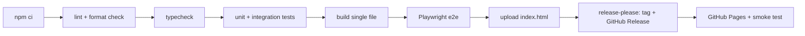

# 13 - Build and CI

## Build

- `npm run build` runs Vite with `vite-plugin-singlefile`, producing a single
  `dist/index.html` with all assets inlined.
- The file can be opened directly in a browser or shared by email or file share.

## Continuous integration

The GitHub Actions workflow [`.github/workflows/ci.yml`](../../.github/workflows/ci.yml)
runs the **test** job on every pull request and every push to `main`. On `main`, the
**release** job runs release-please: it keeps a release PR with the next semantic version and
changelog up to date and auto-merges it once CI passes. Merging that PR creates the `vX.Y.Z` tag
and GitHub Release with the file built by **test** attached. The **deploy** job then publishes
that exact file to GitHub Pages and smoke-tests the live page. A manual run with a `tag` input
redeploys an earlier release (rollback). A new run on a pull request cancels the older one; runs
on `main` always finish, and release and deploy runs queue rather than overlap. `dist/` is a
build output and is not committed.

## Requirements

| ID         | Priority | Description                            | Acceptance criteria                                                                                                                            |
| ---------- | -------- | -------------------------------------- | ---------------------------------------------------------------------------------------------------------------------------------------------- |
| REQ-CI-001 | Must     | CI runs on push and pull request.      | The workflow triggers on `push` and `pull_request`.                                                                                            |
| REQ-CI-002 | Must     | CI runs lint, typecheck and all tests. | Any failure fails the workflow.                                                                                                                |
| REQ-CI-003 | Must     | CI builds the single file.             | `dist/index.html` is built and uploaded as the `jira-gantt-forecaster` artifact.                                                               |
| REQ-CI-004 | Should   | Test reports are kept on failure.      | The Playwright HTML report is uploaded when e2e tests fail.                                                                                    |
| REQ-CI-005 | Should   | Releases include the file.             | Merging the release-please PR creates a `vX.Y.Z` tag and GitHub Release with the tested file attached. Other events do not tag or release.     |
| REQ-CI-006 | Should   | Builds are reproducible.               | Dependencies are installed from `package-lock.json` with `npm ci` on the Node version pinned in `.nvmrc`.                                      |
| REQ-CI-007 | Should   | Releases deploy to GitHub Pages.       | Deploy publishes the release's attached file without rebuilding, a smoke test checks the live version, and a manual run with `tag` rolls back. |
