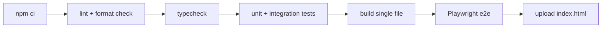

# 13 - Build and CI

## Build

- `npm run build` runs Vite with `vite-plugin-singlefile`, producing a single
  `dist/index.html` with all assets inlined.
- The file can be opened directly in a browser or shared by email or file share.

## Continuous integration

The GitHub Actions workflow [`.github/workflows/ci.yml`](../../.github/workflows/ci.yml)
runs on every push and pull request. A successful push to `main` publishes the next
`v<integer>` release (`v1`, `v2`, `v3`, …) with the built file. Pull requests, manual
runs, and `v*` tag pushes do not publish another release.

## Requirements

| ID         | Priority | Description                            | Acceptance criteria                                                                                                                            |
| ---------- | -------- | -------------------------------------- | ---------------------------------------------------------------------------------------------------------------------------------------------- |
| REQ-CI-001 | Must     | CI runs on push and pull request.      | The workflow triggers on `push` and `pull_request`.                                                                                            |
| REQ-CI-002 | Must     | CI runs lint, typecheck and all tests. | Any failure fails the workflow.                                                                                                                |
| REQ-CI-003 | Must     | CI builds the single file.             | `dist/index.html` is built and uploaded as the `jira-gantt-forecaster` artifact.                                                               |
| REQ-CI-004 | Should   | Test reports are kept on failure.      | The Playwright HTML report is uploaded when e2e tests fail.                                                                                    |
| REQ-CI-005 | Could    | Releases include the file.             | A successful push to `main` publishes the next `v<integer>` release (`v1`, then `v2`) with the built file. Other events do not tag or release. |
| REQ-CI-006 | Should   | Builds are reproducible.               | Dependencies are installed from `package-lock.json` with `npm ci` on the Node version pinned in `.nvmrc`.                                      |
